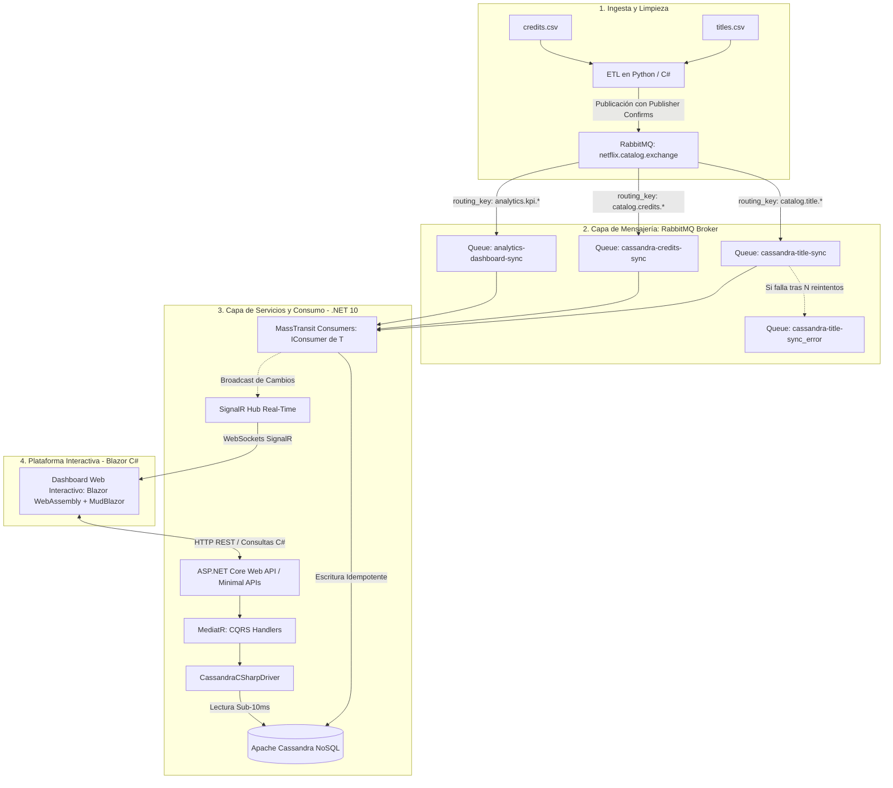
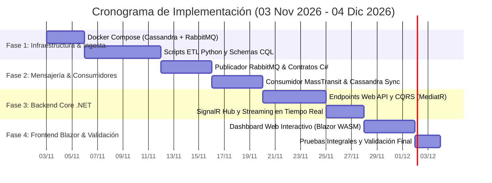

# Documentación Técnica: Plataforma Analítica NoSQL con Apache Cassandra, Mensajería Transaccional con RabbitMQ y Backend .NET

## 1. Definición del Problema y Justificación

### 1.1 Planteamiento del Problema
El análisis y explotación interactiva de catálogos audiovisuales de gran escala (metadatos de producciones, elencos y métricas de recepción de usuarios) imponen exigencias de alta concurrencia y tiempos de respuesta inmediatos. En esquemas relacionales tradicionales:
- Las consultas que cruzan producciones con sus múltiples créditos y desgloses por géneros sufren por la sobrecarga de uniones relacionales (`JOIN` pesados) sobre más de 81,000 registros de créditos y 6,000 títulos.
- Las tareas de ingesta, cálculo de métricas analíticas y sincronización de vistas compiten directamente con las consultas de lectura del usuario, generando bloqueos y degradación en la interfaz.
- La ausencia de una capa desacoplada de mensajería asíncrona impide aislar los fallos: un error temporal en el almacenamiento interrumpe todo el flujo de ingesta o procesamiento analítico.

### 1.2 Justificación de la Solución
Para solucionar esta problemática, se implementa una **Arquitectura Guiada por Eventos (EDA)** con almacenamiento NoSQL y mensajería distribuida:
- **Apache Cassandra:** Repositorio NoSQL distribuido que permite diseñar modelos desnormalizados orientados estrictamente a patrones de consulta (*Query-Driven Modeling*). Garantiza lecturas de alto rendimiento (sub-10ms) sin operaciones `JOIN`.
- **Mensajería con RabbitMQ y MassTransit en .NET:** Proporciona un canal robusto, ligero y transaccional mediante confirmaciones de publicación (*Publisher Confirms*), enrutamiento flexible por *Exchanges*, manejo automático de reintentos con *backoff* exponencial y colas de descarte de errores (*Dead Letter Queues - DLQ*). Desacopla la ingesta de datos del procesamiento en Cassandra y facilita el escalado horizontal de consumidores.
- **Backend en .NET 10 (C#):** Provee una capa de servicios de alto rendimiento con ASP.NET Core, integrando el patrón CQRS (MediatR), consumidores tipados de MassTransit y comunicación bidireccional en tiempo real con **SignalR** para alimentar dashboards interactivos.

---

## 2. Objetivos del Proyecto

### 2.1 Objetivo General
Diseñar, implementar y documentar una plataforma interactiva de analítica para el catálogo de Netflix, sustentada en un Data Mart NoSQL en **Apache Cassandra**, una capa de mensajería asíncrona y transaccional con **RabbitMQ / MassTransit**, y un backend en **.NET** con visualización en tiempo real vía **SignalR**.

### 2.2 Objetivos Específicos
1. **Pipeline de Ingesta y Limpieza:** Extraer, limpiar y transformar los datos de `titles.csv` y `credits.csv` desde datasets de Kaggle mediante scripts en Python.
2. **Mensajería Asíncrona Confiable:** Configurar **RabbitMQ** con *Topic Exchanges*, colas durables y confirmaciones de entrega (*Publisher Confirms*), gestionadas en .NET mediante **MassTransit**.
3. **Modelado NoSQL Orientado a Consultas:** Diseñar un keyspace en Apache Cassandra con tablas desnormalizadas, Tipos Definidos por el Usuario (UDTs) y particionamiento eficiente que erradique los `JOIN`.
4. **Backend y Consumidores Idempotentes en .NET:** Implementar servicios REST y consumidores (`IConsumer<T>`) que procesen eventos de RabbitMQ, garanticen idempotencia en Cassandra y expongan endpoints bajo CQRS (MediatR).
5. **Capa en Tiempo Real y Visualización:** Integrar **ASP.NET Core SignalR** para la emisión en vivo de cambios y métricas del Data Mart hacia un dashboard web interactivo.

---

## 3. Análisis de la Fuente de Datos (`archive/`)

El sistema procesa dos datasets fuente ubicados en el repositorio:

| Dataset | Volumen | Columnas Clave | Características y Tratamiento Técnico |
| :--- | :--- | :--- | :--- |
| **`titles.csv`** | **6,137** registros | `id`, `title`, `type` (`MOVIE`, `SHOW`), `release_year` (1945–2023), `runtime`, `genres`, `production_countries`, `seasons`, `imdb_score`, `tmdb_popularity` | - Atributos tipo colección (`genres`, `production_countries`) serializados como texto (`"['drama', 'sport']"`). Requieren deserialización a colecciones tipadas (`set<text>`).<br>- Tratamiento de valores nulos en `seasons` (solo aplica a series) y métricas no evaluadas. |
| **`credits.csv`** | **81,355** registros | `person_id`, `id` (FK a título), `name`, `character`, `role` (`ACTOR`: 76,570; `DIRECTOR`: 4,785) | - Relación 1:N respecto a títulos: un título agrupa múltiples actores y directores.<br>- 5,788 títulos tienen créditos vinculados.<br>- Se desnormaliza embebiendo el reparto dentro del registro del título para evitar consultas secundarias. |

---

## 4. Análisis AS-IS vs. TO-BE

| Dimensión | AS-IS (Situación Inicial - Relacional / Archivos Planos) | TO-BE (Arquitectura NoSQL, RabbitMQ y .NET) |
| :--- | :--- | :--- |
| **Estructura de Datos** | Archivos planos CSV aislados (`titles.csv` y `credits.csv`) con relaciones 1:N rígidas y dispersas. | Modelo NoSQL desnormalizado en **Apache Cassandra**, estructurado a la medida de cada pantalla y consulta. |
| **Rendimiento de Consultas** | `JOIN` pesados entre más de 81,000 créditos y 6,000 títulos; latencia elevada y consumo intensivo de recursos. | Consultas de lectura directas mediante llaves de partición y ordenamiento por clustering; latencias sub-10ms sin `JOIN`. |
| **Integridad y Mensajería** | Ingesta acoplada y síncrona; si un paso falla se detiene todo el proceso sin mecanismos de recuperación. | **RabbitMQ + MassTransit**: Comunicación asíncrona desacoplada con *Publisher Confirms*, reintentos automáticos y colas de error (*DLQ*). |
| **Manejo de Errores y Resiliencia** | Fallos silenciosos o scripts interrumpidos; requiere reprocesamiento manual y depuración a ciegas. | Políticas de reintento exponencial, cola `_error` para inspección en el **RabbitMQ Management Dashboard**. |
| **Consumo y Visualización** | Consultas estáticas sin capa unificada de métricas ni propagación en tiempo real. | Backend en **.NET** con **CQRS (MediatR)**, emisión en tiempo real vía **SignalR WebSockets** y dashboard analítico interactivo. |

---

## 5. Arquitectura Global del Sistema



---

## 6. Diseño de Mensajería con RabbitMQ y MassTransit

### 6.1 Topología de RabbitMQ
- **Exchange Principal:** `netflix.catalog.exchange` (Tipo: `topic`, durable).
- **Esquema de Enrutamiento (`Routing Keys`):**
  - `catalog.title.created` / `catalog.title.updated`: Eventos de altas o modificaciones de títulos.
  - `catalog.credits.assigned`: Eventos de reparto y equipo vinculados.
  - `analytics.kpi.recalculated`: Eventos de cálculo de métricas para el dashboard.
- **Colas y Garantías de Entrega:**
  - `cassandra-title-sync`: Consumida por el worker .NET para actualizar las tablas desnormalizadas en Cassandra.
  - `cassandra-credits-sync`: Para sincronizar la filmografía de actores/directores.
  - `analytics-dashboard-sync`: Para emitir actualizaciones a SignalR.
  - **Dead Letter Queue (DLQ):** MassTransit genera automáticamente colas con sufijo `_error` ante excepciones no recuperables, garantizando cero pérdida de mensajes.

### 6.2 Contratos de Mensajes en C# (Eventos Fuertemente Tipados)

```csharp
namespace NetflixAnalytics.Contracts.Events
{
    public record CreditRecord(long PersonId, string Name, string Role, string Character);

    public record TitleUpsertedEvent
    {
        public Guid EventId { get; init; } = Guid.NewGuid();
        public DateTime Timestamp { get; init; } = DateTime.UtcNow;
        public string Id { get; init; } = string.Empty;
        public string Title { get; init; } = string.Empty;
        public string Type { get; init; } = string.Empty;
        public string Description { get; init; } = string.Empty;
        public int ReleaseYear { get; init; }
        public string AgeCertification { get; init; } = string.Empty;
        public int Runtime { get; init; }
        public List<string> Genres { get; init; } = new();
        public double ImdbScore { get; init; }
        public double ImdbVotes { get; init; }
        public double TmdbPopularity { get; init; }
        public double TmdbScore { get; init; }
        public List<CreditRecord> Credits { get; init; } = new();
    }

    public record KpiRecalculatedEvent(string Genre, string Type, int Decade, long TotalTitles);
}
```

### 6.3 Configuración de MassTransit en .NET (`Program.cs`)

```csharp
builder.Services.AddMassTransit(x =>
{
    // Escaneo y registro automático de todos los consumidores
    x.AddConsumers(typeof(Program).Assembly);

    x.UsingRabbitMq((context, cfg) =>
    {
        cfg.Host("localhost", "/", h =>
        {
            h.Username("guest");
            h.Password("guest");
        });

        // Política de reintentos ante desconexión o lentitud de Cassandra
        cfg.UseMessageRetry(retry => 
            retry.Exponential(5, TimeSpan.FromSeconds(1), TimeSpan.FromSeconds(30), TimeSpan.FromSeconds(5)));

        // Configuración automática de colas basadas en los consumidores
        cfg.ConfigureEndpoints(context);
    });
});
```

### 6.4 Implementación del Consumidor Idempotente

```csharp
public class TitleUpsertedConsumer : IConsumer<TitleUpsertedEvent>
{
    private readonly ICassandraService _cassandraService;
    private readonly IHubContext<AnalyticsHub> _hubContext;
    private readonly ILogger<TitleUpsertedConsumer> _logger;

    public TitleUpsertedConsumer(
        ICassandraService cassandraService, 
        IHubContext<AnalyticsHub> hubContext,
        ILogger<TitleUpsertedConsumer> logger)
    {
        _cassandraService = cassandraService;
        _hubContext = hubContext;
        _logger = logger;
    }

    public async Task Consume(ConsumeContext<TitleUpsertedEvent> context)
    {
        var evt = context.Message;
        _logger.LogInformation("Procesando evento {EventId} para título {TitleId}", evt.EventId, evt.Id);

        // 1. Inserción idempotente en Cassandra en las tablas correspondientes
        await _cassandraService.UpsertTitleAsync(evt);

        // 2. Notificación en tiempo real al frontend interactivo
        await _hubContext.Clients.All.SendAsync("CatalogUpdated", new 
        { 
            id = evt.Id, 
            title = evt.Title, 
            year = evt.ReleaseYear,
            score = evt.ImdbScore 
        });
    }
}
```

---

## 7. Modelado NoSQL en Apache Cassandra (Data Mart Analítico)

Keyspace: `netflix_analytics`  
Estrategia: `SimpleStrategy`, `replication_factor: 1` (desarrollo local) o `NetworkTopologyStrategy` (producción).

### 7.1 Definición de Tipos de Usuario (UDT) y Tablas CQL

```cql
CREATE KEYSPACE IF NOT EXISTS netflix_analytics
WITH replication = {'class': 'SimpleStrategy', 'replication_factor': 1};

USE netflix_analytics;

-- ============================================================================
-- 1. UDT: Resumen de Créditos (Para embeber dentro de la ficha técnica)
-- ============================================================================
CREATE TYPE IF NOT EXISTS netflix_analytics.credit_summary (
    person_id bigint,
    name text,
    role text,
    character text
);

-- ============================================================================
-- 2. TABLA: Ficha 360° de Título (Lectura instantánea de metadatos + elenco)
-- Patrón: Obtener detalle completo de un título por ID sin JOINs.
-- ============================================================================
CREATE TABLE IF NOT EXISTS netflix_analytics.titles_by_id (
    id text PRIMARY KEY,
    title text,
    type text,
    description text,
    release_year int,
    age_certification text,
    runtime int,
    genres set<text>,
    imdb_score double,
    imdb_votes double,
    tmdb_popularity double,
    tmdb_score double,
    credits list<frozen<credit_summary>>
);

-- ============================================================================
-- 3. TABLA: Navegación por Catálogo (Tipo y Año con orden por calificación)
-- Patrón: Explorador interactivo por series/películas y año reciente.
-- ============================================================================
CREATE TABLE IF NOT EXISTS netflix_analytics.titles_by_type_year (
    type text,
    release_year int,
    imdb_score double,
    id text,
    title text,
    runtime int,
    genres set<text>,
    PRIMARY KEY ((type), release_year, imdb_score, id)
) WITH CLUSTERING ORDER BY (release_year DESC, imdb_score DESC, id ASC);

-- ============================================================================
-- 4. TABLA: Explorador por Género
-- Patrón: Filtrar contenidos por categoría individual (explode en ETL/Consumer).
-- ============================================================================
CREATE TABLE IF NOT EXISTS netflix_analytics.titles_by_genre (
    genre text,
    type text,
    imdb_score double,
    id text,
    title text,
    release_year int,
    PRIMARY KEY ((genre), type, imdb_score, id)
) WITH CLUSTERING ORDER BY (type ASC, imdb_score DESC, id ASC);

-- ============================================================================
-- 5. TABLA: Filmografía de Actores y Directores
-- Patrón: Buscar trayectoria cronológica y roles de una persona.
-- ============================================================================
CREATE TABLE IF NOT EXISTS netflix_analytics.credits_by_person (
    person_id bigint,
    role text,
    release_year int,
    title_id text,
    title text,
    person_name text,
    character text,
    imdb_score double,
    PRIMARY KEY ((person_id), role, release_year, title_id)
) WITH CLUSTERING ORDER BY (role ASC, release_year DESC, title_id ASC);

-- ============================================================================
-- 6. TABLA: Data Mart de Métricas y Contadores (KPIs para Dashboard)
-- ============================================================================
CREATE TABLE IF NOT EXISTS netflix_analytics.kpi_genres_summary (
    genre text,
    type text,
    decade int,
    total_titles counter,
    PRIMARY KEY ((genre), type, decade)
);

-- ============================================================================
-- 7. TABLA: Registro de Eventos Procesados (Garantía de Idempotencia)
-- ============================================================================
CREATE TABLE IF NOT EXISTS netflix_analytics.processed_events (
    event_id uuid PRIMARY KEY,
    processed_at timestamp,
    event_type text
);
```

---

## 8. Arquitectura del Backend en .NET

### 8.1 Componentes Principales
1. **Acceso a Cassandra (`CassandraCSharpDriver`):**
   - Sesión persistente `ISession` registrada como servicio Singleton.
   - Sentencias preparadas (`PreparedStatement`) para optimizar el plan de ejecución y evitar inyecciones.
   - Mapeo de UDTs `credit_summary` a objetos C#.

2. **Capa CQRS con MediatR:**
   - **Queries (Lecturas ultra rápidas a Cassandra):**
     - `GetTitleByIdQuery` -> Handler consulta `titles_by_id`.
     - `GetCatalogByTypeYearQuery` -> Handler consulta `titles_by_type_year`.
     - `GetTitlesByGenreQuery` -> Handler consulta `titles_by_genre`.
     - `GetPersonFilmographyQuery` -> Handler consulta `credits_by_person`.
   - **Commands (Despacho a RabbitMQ):**
     - `PublishTitleCommand` -> Publica a RabbitMQ mediante `IPublishEndpoint` de MassTransit.

3. **Hub en Tiempo Real (`SignalR`):**
   - Hub: `AnalyticsHub` con endpoints WebSockets.
   - Transmisión en tiempo real al navegador sin requerir *polling* periódico.

---

## 9. Plataforma Interactiva (Frontend en Blazor WebAssembly)

La interfaz de usuario se implementa como una Single Page Application (SPA) con **Blazor WebAssembly en .NET 10** y la librería de componentes **MudBlazor**, logrando una arquitectura **Full-Stack 100% en C#**.

### 9.1 Ventajas Clave de la Elección de Blazor
1. **Librería de Contratos Compartida (`NetflixAnalytics.Shared`):**
   - Las clases DTO (`TitleDetailDto`, `CreditSummaryDto`) y contratos de eventos se comparten directamente entre el backend y el frontend sin necesidad de escribir interfaces duplicadas en TypeScript.
2. **Cliente SignalR Nativo en C#:**
   - Conexión tipada y reactiva utilizando `Microsoft.AspNetCore.SignalR.Client` con soporte automático de reconexión y despacho directo a componentes Razor.
3. **Componentes UI Listos para Producción (MudBlazor):**
   - Sistema de diseño moderno con soporte nativo de tema oscuro (*Dark Mode* estilo Netflix), grids responsivos, tablas paginadas de alta velocidad y gráficos analíticos.

### 9.2 Componentes Principales de la UI (`.razor`)
- **`CatalogExplorer.razor`:**
  - Explorador visual del catálogo organizado en tarjetas tipo streaming.
  - Filtros facetados reactivos por Tipo (`MOVIE` / `SHOW`), rango de años y géneros.
  - Ordenamiento inmediato por puntuaciones IMDb y popularidad TMDB.
- **`TitleDetailModal.razor`:**
  - Ficha 360° desplegada en un diálogo modal.
  - Información técnica, sinopsis y carrusel interactivo del elenco (`credits`) con fotos, nombres y personajes, obtenido en una sola consulta instantánea desde Cassandra.
- **`TalentExplorer.razor`:**
  - Buscador predictivo de actores y directores con autocompletado (`MudAutocomplete`).
  - Línea de tiempo cronológica con la filmografía completa de la persona seleccionada.
- **`AnalyticsDashboard.razor`:**
  - Tablero analítico con gráficos interactivos (`MudChart`): barras de producción por década, pastel de distribución por géneros y dispersión de calificaciones.
  - Escucha en tiempo real eventos del Hub de SignalR para refrescar métricas automáticamente.

### 9.3 Integración con SignalR en Blazor (`AppHubConnection.cs`)
```csharp
public class AnalyticsHubClient : IAsyncDisposable
{
    private readonly HubConnection _hubConnection;
    public event Action<string, string>? OnCatalogUpdated;

    public AnalyticsHubClient(NavigationManager navigation)
    {
        _hubConnection = new HubConnectionBuilder()
            .WithUrl(navigation.ToAbsoluteUri("/hubs/analytics"))
            .WithAutomaticReconnect()
            .Build();

        _hubConnection.On<string, string>("CatalogUpdated", (id, title) =>
        {
            OnCatalogUpdated?.Invoke(id, title);
        });
    }

    public async Task StartAsync() => await _hubConnection.StartAsync();
    public async ValueTask DisposeAsync() => await _hubConnection.DisposeAsync();
}
```

---

## 10. Despliegue Local con Docker Compose

Entorno de desarrollo local ligero, rápido y con consola de administración web incluida para RabbitMQ:

```yaml
version: '3.8'

services:
  # Cassandra NoSQL
  cassandra:
    image: cassandra:4.1
    container_name: netflix-cassandra
    ports:
      - "9042:9042"
    environment:
      - CASSANDRA_CLUSTER_NAME=NetflixCluster
      - CASSANDRA_DC=datacenter1
    volumes:
      - cassandra_data:/var/lib/cassandra

  # RabbitMQ con Consola de Administración Web
  rabbitmq:
    image: rabbitmq:3-management
    container_name: netflix-rabbitmq
    ports:
      - "5672:5672"    # Puerto AMQP de mensajería para .NET y Python
      - "15672:15672"  # Consola web de administración (http://localhost:15672)
    environment:
      - RABBITMQ_DEFAULT_USER=guest
      - RABBITMQ_DEFAULT_PASS=guest
    volumes:
      - rabbitmq_data:/var/lib/rabbitmq

volumes:
  cassandra_data:
  rabbitmq_data:
```

---

## 11. Roadmap de Implementación

El cronograma oficial de ejecución abarca del **martes 3 de noviembre de 2026** al **viernes 4 de diciembre de 2026**, estructurado en cuatro fases progresivas:



### 11.1 Equipo del Proyecto y Asignación de Roles

| Integrante | Rol Principal | Especialidad y Área de Responsabilidad |
| :--- | :--- | :--- |
| **Diana Paola Montes** | **Líder de Datos NoSQL & Pipeline ETL** | Modelado orientado a consultas en Cassandra, definición de UDTs/schemas CQL, orquestación de Docker Compose y desarrollo del pipeline ETL en Python para extracción y limpieza de datasets. |
| **Jonathan Cervantes** | **Ingeniero de Mensajería & Consumidores** | Topología de RabbitMQ (`topic exchanges`, colas y DLQ), contratos tipados de eventos C#, implementación de publicadores y consumidores asíncronos con MassTransit y lógica de idempotencia. |
| **Fernanda Baez** | **Ingeniera de Backend .NET & APIs** | Desarrollo de servicios en ASP.NET Core, arquitectura CQRS con MediatR (Handlers de comandos y consultas), integración del conector `CassandraCSharpDriver` y Hub de SignalR en tiempo real. |
| **Ximena Jasso** | **Ingeniera de Frontend Blazor & UI/UX** | Diseño y desarrollo de la SPA en Blazor WebAssembly (.NET 10) con MudBlazor, componentes interactivos (catálogo, ficha 360°, buscador de talento y dashboard analítico), cliente SignalR y pruebas de validación. |

---

### 11.2 Tabla de Hitos, Responsables y Entregables por Fase

| Fase | Período | Responsable Principal | Entregables y Tareas Asignadas |
| :--- | :---: | :--- | :--- |
| **Fase 1: Infraestructura & Ingesta** | **03/Nov – 12/Nov** | **Diana Paola Montes** | - Orquestación de contenedores Docker (`cassandra:4.1` y `rabbitmq:3-management`).<br>- Desarrollo de scripts de limpieza y transformación en Python (`titles.csv` y `credits.csv`).<br>- Creación de Keyspace `netflix_analytics`, UDTs y tablas desnormalizadas en Cassandra. |
| **Fase 2: Mensajería & Consumidores** | **12/Nov – 20/Nov** | **Jonathan Cervantes** | - Configuración del Exchange `netflix.catalog.exchange` y colas de sincronización con RabbitMQ.<br>- Definición de contratos C# (`TitleUpsertedEvent`, `KpiRecalculatedEvent`).<br>- Implementación de consumidores MassTransit (`IConsumer<T>`) con reintentos exponenciales y persistencia en Cassandra. |
| **Fase 3: Backend Core .NET** | **20/Nov – 28/Nov** | **Fernanda Baez** | - Construcción de Web API en .NET con endpoints Minimal APIs y handlers CQRS (MediatR).<br>- Implementación de repositorios de lectura de alta velocidad con `CassandraCSharpDriver`.<br>- Desarrollo del Hub de SignalR (`AnalyticsHub`) para streaming de métricas hacia el cliente. |
| **Fase 4: Frontend Blazor & Validación** | **28/Nov – 04/Dic** | **Ximena Jasso** *(con apoyo de todo el equipo)* | - Desarrollo de la Single Page Application con Blazor WebAssembly y MudBlazor.<br>- Vistas: `CatalogExplorer`, `TitleDetailModal`, `TalentExplorer` y `AnalyticsDashboard`.<br>- Conexión al Hub de SignalR en C# para refresco en tiempo real.<br>- Ejecución de pruebas de carga, latencia y validación analítica final. |
