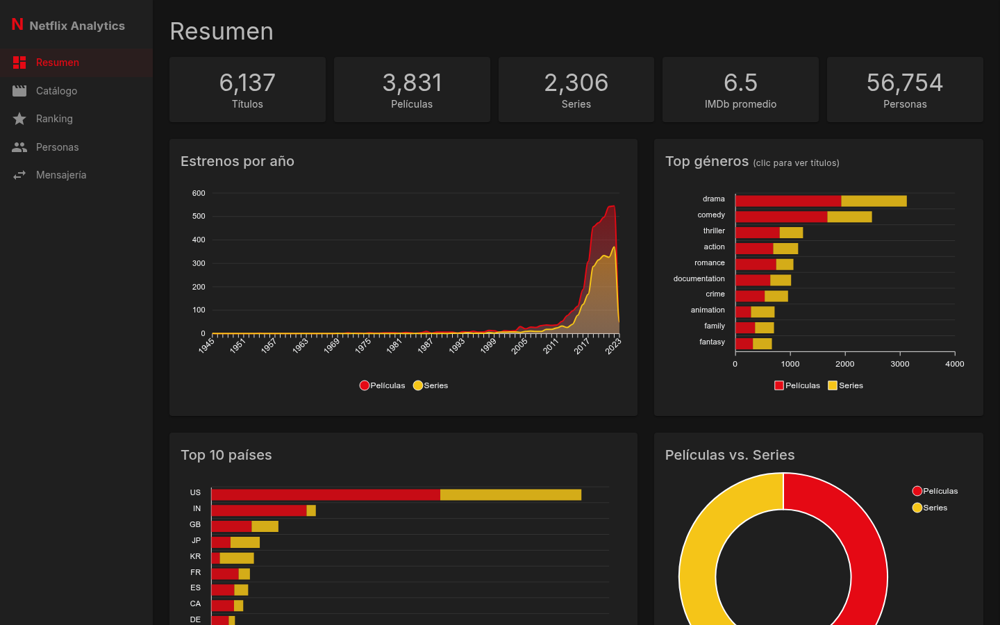
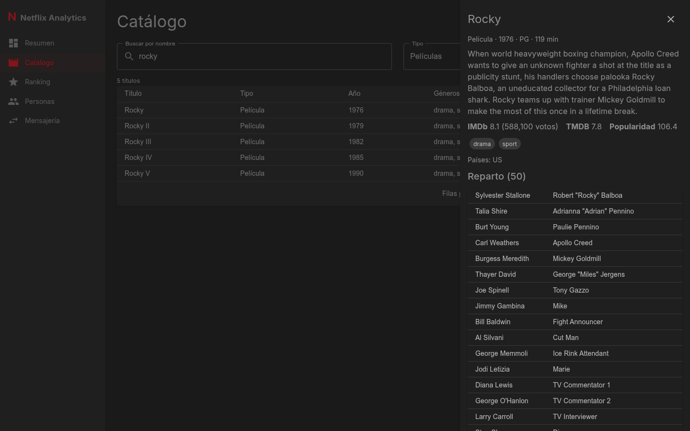
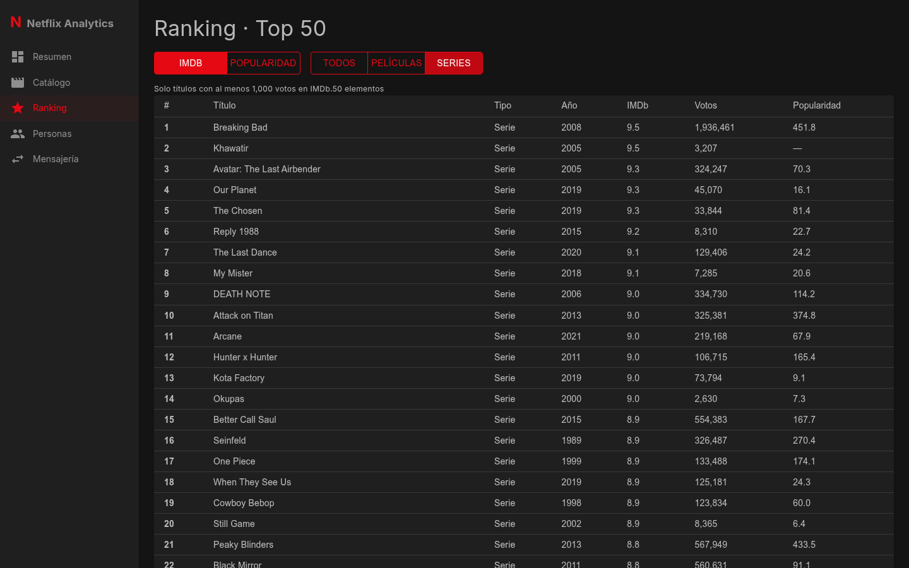
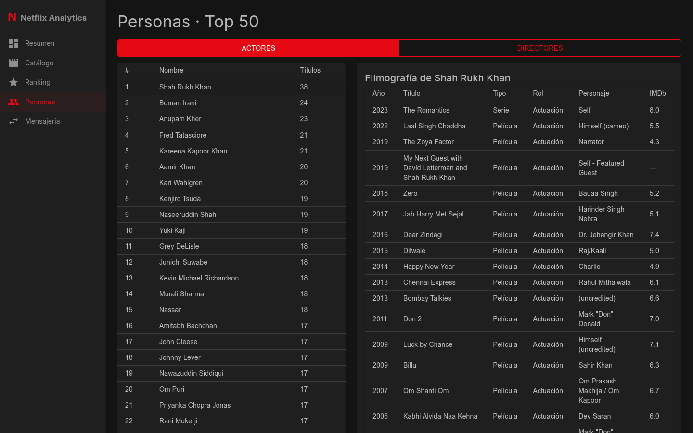
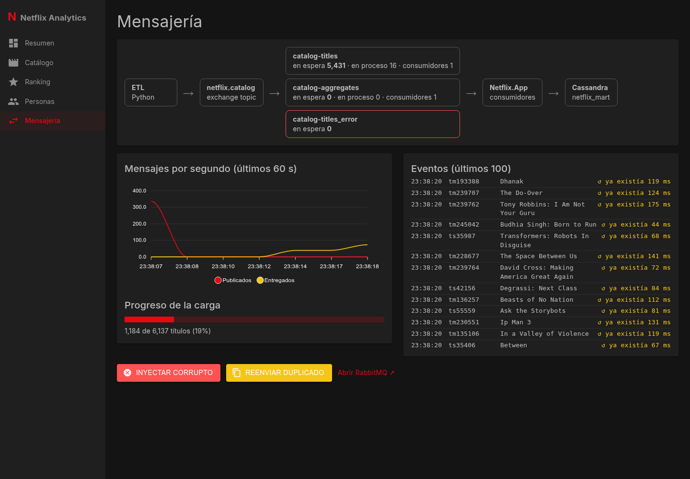
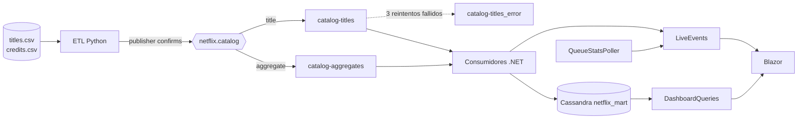

# Informe: Plataforma Netflix Analytics

Proyecto de Bases de Datos NoSQL. Informe de la implementación, escrito el 25 de noviembre de 2026.

## 1. Resumen

La plataforma está implementada y funciona de punta a punta en Docker. Un ETL en Python publica el catálogo en RabbitMQ, una aplicación .NET 10 lo guarda en Cassandra y un dashboard Blazor de 5 vistas lo muestra.

| Aspecto | Resultado |
|---|---|
| Tareas de `tasks.md` | 20 de 21. Falta 6.4: el guion está escrito, pero el equipo debe ensayarlo |
| Pruebas | 29 en verde: 18 de Python y 11 de .NET |
| Datos cargados | 6,137 títulos (3,831 películas y 2,306 series), 56,754 personas |
| Durabilidad | Con la app detenida quedaron 5,869 títulos en espera; al volver, todos se procesaron |
| Entrega en Git | Una rama por grupo, con push. Ningún merge |

## Índice

- [Resumen](#1-resumen)
- [Glosario](#glosario)
- Parte A. Uso: [requisitos](#2-requisitos-de-la-máquina) · [levantar y cargar](#3-levantar-cargar-y-reiniciar) · [las cinco vistas](#4-las-cinco-vistas) · [demo](#5-cómo-hacer-la-demo)
- Parte B. Técnica: [arquitectura](#6-arquitectura) · [ETL](#7-el-etl) · [un mensaje de punta a punta](#8-un-mensaje-de-punta-a-punta) · [las 9 tablas](#9-las-9-tablas) · [lectura e interfaz](#10-lectura-e-interfaz) · [decisiones](#11-decisiones-de-diseño)
- Parte C. [Cómo se construyó](#12-cómo-se-construyó) · [pruebas](#13-pruebas) · [limitaciones y pendientes](#14-limitaciones-y-pendientes)

## Glosario

| Término | Qué significa aquí |
|---|---|
| ETL | Extraer, transformar y cargar: el programa Python que lee los CSV, los limpia y los envía |
| RabbitMQ | El intermediario de mensajes: recibe lo que publica el ETL y lo entrega a la app |
| Exchange | La "ventanilla" donde se publica. Aquí `netflix.catalog`; reparte los mensajes entre colas |
| Routing key | Etiqueta que decide a qué cola va un mensaje: `title` → `catalog-titles`, `aggregate` → `catalog-aggregates` |
| Cola durable | Fila de mensajes que se guarda en disco y sobrevive a reinicios |
| Consumidor | El código de la app que recibe mensajes de una cola. `TitleConsumer` guarda títulos |
| Publisher confirms | El broker responde al ETL "recibido" por cada mensaje |
| Ack | La confirmación del consumidor: "procesado, ya puedes borrarlo". Sin ack, el mensaje vuelve a la cola |
| Cola de errores (DLQ) | Donde queda un mensaje que falló tras los reintentos: `catalog-titles_error` |
| Upsert | Insertar o, si la clave ya existe, sobrescribir. En Cassandra todo `INSERT` es un upsert |
| Idempotencia | Repetir una operación no cambia el resultado: cargar Rocky dos veces deja un solo Rocky |
| "Al menos una vez" | Un mensaje nunca se pierde, pero podría llegar repetido |
| Keyspace | El equivalente a una base de datos en Cassandra: `netflix_mart` |
| Partición | Grupo de filas que se guardan juntas y se leen de una vez, definido por la primera parte de la clave |
| Columnas de ordenamiento (clustering) | El resto de la clave: deciden el orden dentro de la partición |
| UDT | Tipo definido por el usuario. `credit` agrupa persona, nombre, personaje y rol |
| Data Mart | Almacén preparado para análisis. Aquí, tablas pensadas para cada pantalla |
| KPI | Cifra principal de un vistazo: total de títulos, IMDb promedio |
| Blazor Server / circuito | La interfaz se ejecuta en el servidor y el navegador se actualiza por una conexión viva (el circuito) |
| Management API | Interfaz HTTP de RabbitMQ que informa el estado de las colas |

# Parte A. Uso

## 2. Requisitos de la máquina

- Docker con Compose.
- Alrededor de 2 GB de RAM libres. Medido en reposo: Cassandra 1.2 GB, RabbitMQ 132 MB y la app 120 MB.
- Puertos 8080 (dashboard, configurable con `APP_PORT`), 15672 (consola de RabbitMQ), 5672 (AMQP) y 9042 (Cassandra).
- Para las pruebas: Python 3.13 y el SDK de .NET 10.

El equipo de desarrollo tiene 2 CPU y 5.7 GB de RAM y se saturaba. Por eso cada contenedor tiene un límite de CPU en `docker-compose.yml`: Cassandra 1.0; RabbitMQ, app, ETL y el inicializador 0.5. Se puede subir en máquinas más grandes.

## 3. Levantar, cargar y reiniciar

### 3.1 Primer uso, paso a paso

1. En la carpeta del proyecto ejecuta `docker compose up -d --build`.
2. Espera. Cassandra puede tardar uno o dos minutos; la primera vez se suman las descargas.
3. Comprueba con `docker compose ps -a`:

| Servicio | Estado correcto |
|---|---|
| `cassandra` | `Up (healthy)` |
| `rabbitmq` | `Up (healthy)` |
| `cassandra-init` | `Exited (0)`: aplicó el esquema y terminó |
| `app` | `Up` |

4. Abre <http://localhost:8080>. Verás "Aún no hay datos".
5. Ejecuta `docker compose run --rm etl`. Termina con una línea "Resumen: 6137 títulos y 6 agregados confirmados".
6. Espera unos segundos a que la app vacíe la cola (se ve en Mensajería) y entra a Resumen.

La consola de RabbitMQ está en <http://localhost:15672>, usuario `guest`, contraseña `guest`.

### 3.2 Si algo falla

| Síntoma | Causa y solución |
|---|---|
| "port is already allocated" | Otro programa usa el puerto; para el dashboard usa `APP_PORT=8081` |
| La app no arranca o tarda | Cassandra aún no está `healthy`: espera |
| La página sale en negro | Revisa `docker compose logs app` y reconstruye con `docker compose up -d --build app` |
| "Aún no hay datos" después de cargar | La app aún está procesando o está detenida: `docker compose ps` |
| "Reenviar duplicado" deshabilitado | La app acaba de arrancar y no ha recibido ningún título |

### 3.3 Comandos

```bash
docker compose up -d --build           # Cassandra, esquema, RabbitMQ y la app
docker compose run --rm etl            # carga el catálogo
docker compose run --rm etl --rate 60  # carga lenta (~100 s de publicación), para verla fluir
docker compose stop                    # detiene sin borrar datos
docker compose down -v                 # borra todo, incluidos los datos
```

- La primera vez tarda más porque descarga imágenes y compila.
- Si el 8080 está ocupado: `APP_PORT=8081 docker compose up -d`. En el equipo de desarrollo lo ocupa otro proyecto (`tutorias_web`), así que se probó en el 8081.
- Si cambias el código del ETL, ejecuta `docker compose --profile tools build etl`.
- Cargar dos veces es seguro: no duplica títulos.

**Velocidad observada con los límites de CPU:** tras unos 10 s de arranque, la app procesó alrededor de 170–190 títulos por segundo y vació 5,431 pendientes en unos 40 s. Por eso con `--rate 60` la cola se mantiene casi vacía mientras la app está viva. Son cifras de este equipo, tomadas de la gráfica de Mensajería.

## 4. Las cinco vistas

Antes de cargar datos, las vistas de datos muestran "Aún no hay datos: ejecuta `docker compose run --rm etl`".

### 4.1 Resumen

- Cinco tarjetas: títulos, películas, series, IMDb promedio y personas.
- Estrenos por año (área), con películas en rojo y series en amarillo.
- Los 10 géneros y los 10 países con más títulos (barras apiladas).
- Dona de películas contra series.
- Al hacer clic en una barra de género se abre un panel con sus 20 títulos mejor puntuados.



### 4.2 Catálogo

- Tabla paginada de todos los títulos, con búsqueda por nombre y filtros de tipo y género.
- La columna IMDb se puede ordenar.
- Clic en una fila: panel con sinopsis, año, clasificación, duración o temporadas, puntuaciones, géneros, países y reparto.



### 4.3 Ranking

- Top 50 por IMDb o por popularidad de TMDB.
- Filtro: todos, películas o series.
- El ranking por IMDb solo incluye títulos con 1,000 votos o más.



### 4.4 Personas

- Top 50 de actores o de directores, por número de títulos.
- Clic en una persona: su filmografía, del año más reciente al más antiguo, con rol y personaje.



### 4.5 Mensajería

- Diagrama ETL → exchange → colas → app → Cassandra, con mensajes en espera, en proceso y consumidores.
- Gráfica de mensajes publicados y entregados por segundo (media móvil de 10 s, últimos 60 s).
- Barra de progreso de la carga.
- Feed de los últimos 100 eventos: nuevo, ya existía o error, con el tiempo de proceso.
- Botones **Inyectar corrupto** y **Reenviar duplicado**, y enlace a RabbitMQ.



## 5. Cómo hacer la demo

El guion minuto a minuto está en [GUION-DEMO.md](GUION-DEMO.md). Las tres demostraciones clave:

| Demostración | Pasos | Qué se observa |
|---|---|---|
| Cola de errores (DLQ) | Botón "Inyectar corrupto" | Tras 3 reintentos aparece un error en el feed y `catalog-titles_error` sube en 1 |
| Sin duplicados | Botón "Reenviar duplicado" | El feed dice "ya existía" y el KPI no cambia |
| Durabilidad | `docker compose stop app` a mitad de una carga y luego `start` | La cola retiene los mensajes y baja a 0 al volver |

"Reenviar duplicado" se activa cuando la app ya recibió al menos un título desde que arrancó.

### 5.1 Durabilidad, paso a paso

1. Abre la consola de RabbitMQ en la pestaña **Queues**.
2. Terminal 1: `docker compose run --rm etl --rate 60`.
3. A los 30–40 s, terminal 2: `docker compose stop app`.
4. En RabbitMQ, `catalog-titles` pasa a 0 consumidores y "Ready" crece. La vista Mensajería no se puede ver ahora, porque la sirve la app detenida.
5. Terminal 2: `docker compose start app`.
6. Recarga Mensajería: vuelve el consumidor y los mensajes en espera bajan a 0.

# Parte B. Técnica

## 6. Arquitectura



Reglas de la arquitectura:

- **Un solo camino de escritura.** Solo los consumidores escriben en Cassandra. El ETL publica y la interfaz lee.
- **Lectura y escritura separadas por clases**, sin interfaces genéricas ni mediador.
- **Una sola aplicación .NET**: consumidores, consultas y Blazor Server.
- **Tiempo real sin hub propio**: Blazor Server ya mantiene la conexión; `LiveEvents` es un singleton con eventos C#.

### 6.1 Estructura del repositorio

| Ruta | Contenido |
|---|---|
| `docker-compose.yml` | Servicios `cassandra`, `cassandra-init`, `rabbitmq`, `app`, `etl` |
| `cassandra/schema.cql` | Keyspace, tipo `credit` y 9 tablas |
| `rabbitmq/rabbitmq.conf` | Estadísticas cada 1 s |
| `etl/` | `extract`, `transform`, `aggregate`, `publish`, `main` y pruebas |
| `src/Netflix.App/Data/` | `CassandraSession`, `TitleWriter`, `AggregateWriter`, `DashboardQueries` |
| `src/Netflix.App/Messaging/` | Contratos, 3 consumidores, configuración de MassTransit, poller y demo |
| `src/Netflix.App/Live/` | `LiveEvents` |
| `src/Netflix.App/Components/` | Layout, 5 páginas y 2 componentes compartidos |
| `tests/Netflix.App.Tests/` | Pruebas de integración |

Versiones: Cassandra 5.0, RabbitMQ 4, .NET 10, MassTransit 8.5.12 (la 9 requiere licencia comercial), CassandraCSharpDriver 3.22.1, MudBlazor 9.14.0, Blazor-ApexCharts 8.0.0, pandas 3.1.1 y pika 1.5.0.

## 7. El ETL

1. **Extracción** (`extract.py`): lee los CSV como texto, sin interpretar nulos (el país `NA` es Namibia). Si falta un archivo, termina sin publicar nada.
2. **Limpieza** (`transform.py`):

| Campo | Regla |
|---|---|
| `genres`, `production_countries` | De texto a lista, sin repetidos; géneros en minúsculas y países en mayúsculas |
| Puntuaciones | Vacías o fuera de 0–10 → nulo |
| `imdb_votes` | A entero |
| `age_certification` | Vacía → `NR` |
| `runtime` | 0 → nulo |
| `seasons` | Nulo en películas |
| Créditos | `character` vacío → nulo; se embeben en su título |
| Filas inválidas | id que no sea `tm…`/`ts…`, tipo distinto de `MOVIE`/`SHOW` o año fuera de 1900–2030: se omiten y se cuentan |

Con los datos actuales se omiten 0 filas.

3. **Agregados** (`aggregate.py`): KPIs, estrenos por año y tipo, totales por género (19) y país (107), 6 rankings top 50 y top 50 de personas por rol. `kpis` se publica al final.
4. **Publicación** (`publish.py`): mensajes persistentes, `confirm_delivery` y `mandatory`. Si el broker rechaza un mensaje o no puede enrutarlo, el ETL termina con código 1. También declara las colas, para no perder mensajes si la app nunca ha arrancado.

## 8. Un mensaje de punta a punta

1. El ETL publica el título en `netflix.catalog` con la routing key `title`. Ejemplo **abreviado** (el contrato completo está en [design D3](../openspec/changes/netflix-analytics-platform/design.md)):

```json
{ "id": "tm82169", "title": "Rocky", "type": "MOVIE", "release_year": 1976,
  "genres": ["drama","sport"], "imdb_score": 8.1,
  "credits": [{ "person_id": 3180, "name": "Sylvester Stallone", "role": "ACTOR" }],
  "position": 2, "total_titles": 6137 }
```

2. RabbitMQ lo confirma y lo guarda en la cola durable `catalog-titles`.
3. `TitleConsumer` valida `id`, `type` y `release_year`.
4. Consulta por clave si el id ya existe (solo para etiquetar el evento).
5. `TitleWriter` hace upsert en `titles_by_id`, `titles_by_genre` (una fila por género) y `credits_by_person` (una fila por crédito), en tandas de 32.
6. Publica el evento en `LiveEvents` y MassTransit confirma el mensaje.
7. La vista Mensajería se redibuja, como máximo 4 veces por segundo.

**Si falla:** 3 reintentos separados 1 s. Después el mensaje pasa a `catalog-titles_error` y `FaultConsumer` avisa a la interfaz. `FaultConsumer` usa una cola temporal que desaparece con la app.

**Integración Python → .NET:** el JSON es plano en snake_case, sin el sobre de MassTransit. Por eso cada cola usa `UseRawJsonDeserializer`, `ConfigureConsumeTopology = false` y un binding explícito.

**Garantía de entrega:** "al menos una vez". La idempotencia por upsert hace que repetir un mensaje no cambie el resultado.

## 9. Las 9 tablas

Cassandra no tiene JOINs ni `GROUP BY` entre particiones, así que hay una tabla por consulta.

La primera parte de la clave es la **partición** y el resto fija el **orden**. En `titles_by_genre`, todos los dramas viven juntos en la partición `drama`, ordenados por `imdb_score` descendente. Por eso el clic en drama es una sola lectura.

| Tabla | Clave primaria (partición entre paréntesis dobles) | Uso |
|---|---|---|
| `titles_by_id` | `(id)`; reparto como `list<frozen<credit>>` | Detalle y catálogo |
| `titles_by_genre` | `((genre), imdb_score DESC, id)`; sin puntuación = -1 | Clic en un género |
| `credits_by_person` | `((person_id), release_year DESC, title_id, role)` | Filmografía |
| `kpis` | `(name)` | Tarjetas |
| `agg_by_year` | `((type), release_year)` | Estrenos por año |
| `agg_by_genre` | `((scope), genre)` | Top géneros |
| `agg_by_country` | `((scope), country)` | Top países |
| `ranking` | `((list_name), position)` | Ranking |
| `top_people` | `((role), position)` | Personas |

El esquema usa `IF NOT EXISTS`: se puede aplicar varias veces sin borrar datos.

## 10. Lectura e interfaz

- `DashboardQueries` tiene un método por gráfica y nunca escribe.
- El Catálogo carga `titles_by_id` una vez y filtra en memoria.
- La caché se descarta cuando llega `kpis`, y solo se conserva si ya hay tantos títulos como indica el KPI.
- Blazor Server sin prerender: cada vista muestra su indicador de carga y consulta una vez.
- `QueueStatsPoller` consulta la Management API cada 2 s.
- Los botones de demo publican en el exchange por esa misma API. No escriben en Cassandra.

## 11. Decisiones de diseño

| Decisión | Motivo | Descartado |
|---|---|---|
| RabbitMQ | Confirmación por mensaje, DLQ nativa y consola visual | Kafka |
| MassTransit 8 | Reintentos, cola `_error` y arnés de pruebas incluidos | Mecanismos propios |
| Idempotencia por upsert | Es gratis en Cassandra | Tabla de mensajes procesados con LWT |
| Agregados en el ETL | pandas tiene todo en memoria | Agregar en la base o en la app |
| Catálogo en memoria | Son ~6 mil filas | Índices secundarios |
| Una sola app .NET | Menos piezas | API REST, MediatR, hub SignalR aparte |

# Parte C. Proceso, pruebas y límites

## 12. Cómo se construyó

El plan estaba escrito en OpenSpec (`openspec/changes/netflix-analytics-platform/`). Se implementó grupo por grupo con Claude Code, verificando cada tarea antes de marcarla. Una segunda sesión de Claude revisó parte del trabajo y propuso simplificaciones.

| Grupo | Rama | Contenido |
|---|---|---|
| 1 | `feat/grupo-1-infraestructura` | Compose, esquema y configuración de RabbitMQ |
| 2 | `feat/grupo-2-etl` | ETL y sus pruebas |
| 3 | `feat/grupo-3-mensajeria` | App, consumidores y escritura |
| 4 | `feat/grupo-4-vistas` | Consultas y 4 vistas |
| 5 | `feat/grupo-5-vista-mensajeria` | Mensajería, poller y botones |
| 6 | `feat/grupo-6-integracion` | Pruebas finales y documentación |

Las ramas están encadenadas: cada una parte de la anterior. Hay que integrar los PR en orden.

### 12.1 Problemas encontrados y solución

| Problema | Cómo se detectó | Solución |
|---|---|---|
| Contenedores anteriores ocupaban los puertos | Revisión previa | Se detuvieron sin borrarlos; el proyecto usa otro nombre y volúmenes propios |
| 351 casos de actor y director en el mismo título se pisaban | Análisis del CSV | `role` entró en la clave de `credits_by_person` |
| `kpis` puede procesarse antes que los títulos (colas distintas) | Diseño de los consumidores | La caché solo se conserva si está completa |
| La barra de progreso no sobrevivía a un reinicio | Diseño | El ETL envía `position` en cada título |
| Página en negro en Docker (`blazor.web.js` 404) | Captura del navegador | El `Dockerfile` copia todo antes de publicar |
| Resumen rompía el circuito (`MudItem md` sin valor) | Recorrido en navegador | Tarjetas en una rejilla CSS |
| Nombres repetidos entre MudBlazor, ApexCharts y el driver | Compilación | Alias y renombrado a `AppTheme` |
| Dependencia vulnerable (`Newtonsoft.Json` 9.0.1, traída por el driver) | Aviso de compilación | Se fijó la 13.0.4 |
| Una prueba dependía de datos de otra | Fallo en `dotnet test` | La prueba vacía sus tablas antes |
| Gráfica de mensajes en dientes de sierra | Captura | Tasa media de 10 s |
| Barra terminada en 6,136 de 6,137 | Captura | Se conserva la posición mayor |
| Equipo saturado (2 CPU) | Carga del sistema | Límites de CPU por contenedor |
| El feed y la gráfica mostraban la hora en UTC | Revisión de la captura | `TZ: America/Mexico_City` en el servicio `app` |

Las pruebas unitarias no habrían detectado los dos fallos de pantalla: solo aparecieron al abrir el navegador.

## 13. Pruebas

### 13.1 Cómo ejecutarlas

```bash
pip install -r etl/requirements.txt
pytest etl/tests

docker compose up -d cassandra
dotnet test
```

Las de .NET usan el Cassandra de Docker en el keyspace `netflix_mart_test`, que recrean cada vez. No tocan los datos reales.

### 13.2 Qué cubren

| Conjunto | Casos |
|---|---|
| Python (18) | Lectura completa, archivo faltante, reglas de limpieza, filas inválidas, Rocky con Stallone, KPIs, 19 géneros y 107 países, mínimo de 1,000 votos, 6 rankings, top personas, JSON válido |
| .NET (11) | Contrato snake_case, título nuevo y repetido, título sin id, KPIs, formato del duplicado de demo, cada consulta devuelve datos, orden por género, búsqueda y detalle de Rocky, caché, progreso y límite del feed |

### 13.3 Verificaciones manuales sobre el sistema completo

| Verificación | Resultado |
|---|---|
| Esquema aplicado dos veces | Código 0 y los datos se conservan |
| Carga desde cero (`down -v`) | 6,137 títulos en `titles_by_id` |
| KPIs en Cassandra | 6,137 / 3,831 / 2,306 / 56,754; IMDb 6.54 |
| Carga con `--rate 60` (antes de poner los límites de CPU) | 104 s; barra y feed avanzan |
| Inyectar corrupto | Cola de errores de 0 a 1 |
| Reenviar duplicado | "ya existía"; KPI sin cambios |
| App detenida durante la carga | 5,869 en espera; al volver, 0 en espera y 6,137 títulos |
| App detenida antes de cargar (repetida al final) | 6,137 en espera; al volver, 0 en espera, barra en 6,137 y 6,137 títulos |
| Vistas en navegador | Clic en drama, "rocky" + Películas, 50 series, filmografía ordenada, sin errores de consola |

Los recorridos en navegador se hicieron con scripts temporales de Playwright que no forman parte del repositorio.

## 14. Limitaciones y pendientes

**Pendiente:**

- Ensayar la demo con el equipo y medir que dure 10 minutos o menos (tarea 6.4).
- Revisar e integrar los PR. Los commits de documentación de `docs/simplificacion` deben estar en `main` o saldrán en los PR de código.
- Actualizar `CLAUDE.md`, que todavía dice que no hay código.

**Limitaciones conocidas:**

- Si una persona interpreta varios personajes en un título, `credits_by_person` guarda uno: de 81,355 créditos quedan 81,270 filas (calculado desde el CSV). El detalle del título conserva todos.
- Si los datos cambiaran entre cargas, podrían quedar filas viejas en `titles_by_genre`, rankings y agregados. Con datos estáticos no ocurre.
- El feed y el progreso viven en memoria: se pierden al reiniciar la app.
- Las tarjetas KPI leen la tabla `kpis` completa (5 filas), no una sola partición.
- Credenciales `guest`/`guest`, un solo nodo y sin autenticación: es un entorno de demostración.
- La fuente Inter se descarga de Google Fonts; sin internet se usa la del sistema.
- No se probó un reinicio del broker con mensajes pendientes ni el caso de un mensaje sin confirmar en el ETL.
- Tras la doble carga se comprobó el KPI y el "ya existía", pero no se volvió a contar la tabla.
