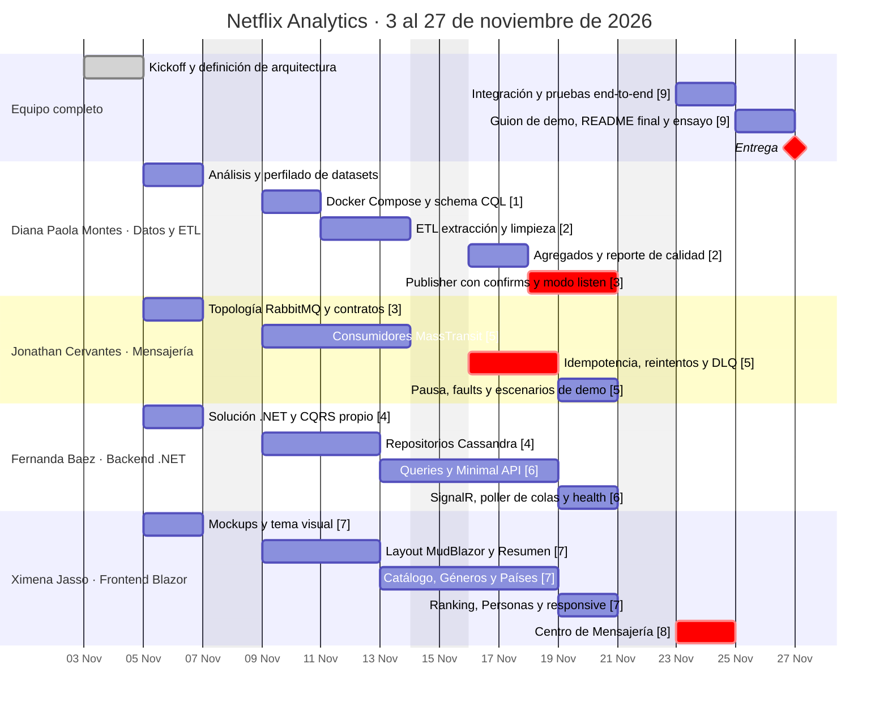

# Cronograma: Plataforma Netflix Analytics

- **Inicio:** martes 3 de noviembre de 2026
- **Entrega:** viernes 27 de noviembre de 2026
- **Jornadas:** días hábiles (lunes a viernes), 4 semanas

Las tareas detalladas de cada barra están en `tasks.md`; los números de grupo se indican entre corchetes.

## Diagrama de Gantt

## Hitos

| Fecha | Hito | Criterio de cumplimiento |
|---|---|---|
| 04-nov | Arquitectura definida | Change OpenSpec con propuesta, diseño, specs y tareas |
| 10-nov | Infraestructura lista | `docker compose up` con Cassandra y RabbitMQ healthy y esquema aplicado |
| 13-nov | Primer flujo de punta a punta | Un título viaja ETL → RabbitMQ → consumidor → Cassandra |
| 18-nov | Ingesta transaccional completa | Idempotencia, reintentos y DLQ probados |
| 20-nov | Datos y API completos | Catálogo completo ingerido y endpoints `/api` respondiendo |
| 24-nov | Dashboard completo | 7 vistas funcionando, incluido el Centro de Mensajería |
| 26-nov | Demo ensayada | Guion ≤ 10 min ejecutado sin fallas |
| 27-nov | **Entrega** | Repositorio, documentación y demo en vivo |

## Ruta crítica

**Publisher con confirms → Idempotencia/DLQ → Centro de Mensajería → Integración.** El Centro de Mensajería depende de que existan los eventos de ingesta y los escenarios de falla, y es la pieza principal de la demo. Por eso las barras marcadas como `crit` no tienen holgura.
