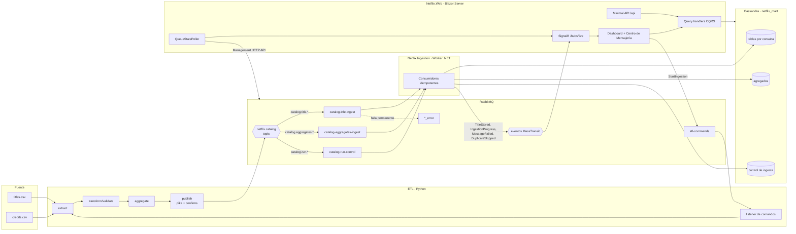

# Diseño: Plataforma Netflix Analytics

## Context

La motivación y el alcance están en `proposal.md`. Este documento cubre el **cómo**.

Estado de partida:
- Solo existen los datos fuente en `archive/` y no hay código.
- Perfil real de los datos, medido sobre los CSV:

| Métrica | Valor |
|---|---|
| Títulos | 6,137: 3,831 `MOVIE` y 2,306 `SHOW`, sin ids duplicados |
| Años de estreno | 1945 – 2023 |
| Géneros distintos | 19 (drama 3,120 · comedy 2,485 · thriller 1,229 …). 57 títulos sin género |
| Países distintos | 107 (US 2,325 · IN 656 · GB 421 …). 176 títulos sin país |
| Nulos relevantes | `imdb_score` 468 · `imdb_votes` 484 · `tmdb_score` 252 · `age_certification` 2,743 · `description` 23 · `runtime = 0` en 19 títulos |
| `seasons` | Nulo exactamente en las 3,831 películas: solo aplica a series |
| Créditos | 81,355: 76,570 `ACTOR` y 4,785 `DIRECTOR`. 56,754 personas distintas |
| Integridad | 0 créditos huérfanos. 5,788 títulos tienen créditos. 10,823 créditos sin `character` |

Restricciones:
- Stack obligatorio: Python, RabbitMQ, Cassandra, .NET y Blazor.
- Todo corre en un portátil con Docker Compose (un nodo de Cassandra).
- Hay que presentar una demo en vivo ante el profesor.

## Goals / Non-Goals

**Goals:**
- Que cualquier pantalla del dashboard se resuelva con **lecturas por clave de partición**, sin JOINs ni agregaciones en tiempo de consulta.
- Una ingesta **demostrablemente transaccional**: confirmación de publicación, reintentos, DLQ e idempotencia, todo observable desde la UI.
- Que reingerir el catálogo completo sea seguro y repetible: el mismo resultado, sin duplicados.
- Arrancar todo el sistema con un solo comando (`docker compose up`).

**Non-Goals:**
- Escalado horizontal real (multinodo, varias réplicas de consumidores). Se diseña para permitirlo, pero no se demuestra.
- Ingesta incremental o CDC. Siempre se procesa el catálogo completo.
- Búsqueda de texto completo con motor dedicado (Elasticsearch, Solr).
- Seguridad: no hay autenticación, TLS ni gestión de secretos más allá de variables de entorno.

## Arquitectura



Solo hay un camino de escritura hacia Cassandra: **ETL → RabbitMQ → Netflix.Ingestion**. `Netflix.Web` solo lee de Cassandra. Las acciones de la UI se traducen en **mensajes**, nunca en escrituras directas.

### Estructura de la solución

```
docker-compose.yml
rabbitmq/rabbitmq.conf          collect_statistics_interval = 1000 (tasas casi en vivo)
cassandra/schema.cql
etl/
  netflix_etl/extract.py        lectura de CSV con dtypes explícitos
  netflix_etl/transform.py      limpieza, validación, embebido de créditos
  netflix_etl/aggregate.py      agregados del Data Mart
  netflix_etl/publish.py        publisher pika con confirms
  netflix_etl/main.py           CLI: `run` (una corrida) y `listen` (espera comandos)
  tests/                        pytest
src/
  Netflix.Contracts/            records de mensajes (compartidos Ingestion/Web)
  Netflix.Core/                 CQRS (IQuery, IQueryHandler, IQueryDispatcher), repositorios Cassandra, modelos de lectura
  Netflix.Ingestion/            Worker Service: MassTransit, consumidores, escritura a Cassandra
  Netflix.Web/                  Blazor Web App (Interactive Server), Minimal API, SignalR hub, poller de colas
tests/
  Netflix.Core.Tests/           xUnit: handlers y mapeos
  Netflix.Ingestion.Tests/      xUnit + MassTransit test harness: idempotencia, reintentos, DLQ
```

## Decisions

### D1. RabbitMQ en lugar de Kafka
RabbitMQ ofrece ack por mensaje, DLQ nativa, enrutamiento por *topic exchange* y una UI de administración lista para enseñar en la demo. Kafka es un log distribuido pensado para streaming y re-lectura. Aquí no se necesita eso, pide más recursos en un portátil y sus "reintentos con DLQ" hay que construirlos a mano.
*Alternativas:* Kafka (descartado por peso y semántica) y Azure Service Bus (requiere nube).

### D2. MassTransit 8.x sobre RabbitMQ
MassTransit da gratis reintentos configurables, colas `_error` automáticas, *test harness*, *fault events* y topología declarativa. Se fija la **8.x** porque la v9 tiene licencia comercial.
*Alternativa:* `RabbitMQ.Client` directo. Habría que reimplementar los reintentos y la DLQ; se usará solo para dos operaciones puntuales de demo (ver D11).

### D3. Contrato Python → .NET: JSON plano + deserializador raw
Python (pika) publica JSON **sin el sobre de MassTransit**. Cada receive endpoint de .NET se configura con:
- `UseRawJsonDeserializer(RawSerializerOptions.AnyMessageType)`;
- `ConfigureConsumeTopology = false`;
- binding explícito al exchange `netflix.catalog` por routing key.

Cada cola tiene **un solo tipo de mensaje**, así que el tipo se deduce del endpoint.

Propiedades AMQP que Python siempre envía:
- `message_id` (UUID);
- `content_type=application/json`;
- `delivery_mode=2` (persistente);
- el header `x-run-id`.

El `message_id` es determinista: `uuid5(NAMESPACE, f"{run_id}:{title_id}")`. Un reenvío dentro de la misma corrida se reconoce como duplicado, y una corrida nueva sí reprocesa (de forma idempotente).

### D4. Topología RabbitMQ

| Exchange / Cola | Tipo | Binding | Productor → Consumidor |
|---|---|---|---|
| `netflix.catalog` | topic, durable | — | ETL Python |
| `catalog-title-ingest` | quorum, durable | `catalog.title.*` | → `TitleIngestedConsumer` |
| `catalog-aggregates-ingest` | quorum, durable | `catalog.aggregates.*` | → `AggregateSnapshotConsumer` |
| `catalog-run-control` | quorum, durable | `catalog.run.*` | → `RunControlConsumer` (started/completed) |
| `*_error` | durable (MassTransit) | — | Mensajes con falla permanente |
| `etl-commands` | durable | — | Web → listener Python (`StartIngestion`) |
| `ingestion-control` | durable | — | Web → Ingestion (`PauseConsumer`/`ResumeConsumer`) |
| Eventos (`TitleStored`, `IngestionProgress`, `MessageFailed`, `DuplicateSkipped`, `RunStateChanged`) | fanout por tipo (MassTransit publish) | — | Ingestion → Web (cola temporal autodelete por instancia) |

Las colas son **quorum** porque replican con Raft y dan la garantía de durabilidad que se defiende en la exposición. En un nodo se comportan igual que las clásicas.

Política de reintentos en `catalog-title-ingest`:
- `UseMessageRetry(r => r.Exponential(3, 1s, 10s, 2s))`;
- `Ignore<ValidationException>()`: los errores de validación son **permanentes** y van directo a `_error`, sin reintentar;
- las excepciones de Cassandra (`OperationTimedOut`, `NoHostAvailable`, `WriteTimeout`) se reintentan.

Publisher confirms en Python:
- `channel.confirm_delivery()` + `mandatory=True`;
- si llega `UnroutableError`/`NackError`, se reintenta 3 veces y después se registra en `rejected_publish.jsonl`;
- la corrida termina con exit code ≠ 0 si queda algún mensaje sin confirmar.

### D5. Contratos de mensajes

```jsonc
// catalog.title.upsert  → TitleIngested
{
  "run_id": "0b9c…", "title_id": "tm82169",
  "title": { "id": "tm82169", "title": "Rocky", "type": "MOVIE", "description": "…",
             "release_year": 1976, "decade": 1970, "age_certification": "PG",
             "runtime": 119, "genres": ["drama","sport"], "production_countries": ["US"],
             "seasons": null, "imdb_id": "tt0075148", "imdb_score": 8.1, "imdb_votes": 588100,
             "tmdb_popularity": 106.361, "tmdb_score": 7.782 },
  "credits": [ { "person_id": 3180, "name": "Sylvester Stallone",
                 "character": "Robert \"Rocky\" Balboa", "role": "ACTOR" } ],
  "published_at": "2026-11-20T18:00:00Z"
}
// catalog.aggregates.<kind> → AggregateSnapshot   kind ∈ kpis|by_year|genre_summary|genre_decade|country|age_certification|top_people|ranking
{ "run_id": "…", "kind": "genre_decade", "rows": [ { "genre": "drama", "decade": 2010, "movies": 812, "shows": 402, "total": 1214, "avg_imdb": 6.6 } ] }
// catalog.run.started / catalog.run.completed → RunStarted / RunCompleted
{ "run_id": "…", "expected_titles": 6137, "expected_aggregates": 8, "rejected_rows": 0, "at": "…" }
```

En .NET se modelan como `record` en `Netflix.Contracts`, con `JsonPropertyName` en snake_case.

### D6. Data Mart NoSQL orientado a consultas (en vez del Data Mart relacional)
Cassandra no tiene JOINs ni `GROUP BY` entre particiones, así que un esquema estrella no encaja. La regla es **una tabla por patrón de consulta**: la duplicación es intencional y las agregaciones se precalculan antes de escribir.

Keyspace: `netflix_mart`, `SimpleStrategy`, RF=1 (un nodo). Las lecturas usan `LOCAL_ONE` y las LWT usan `SERIAL`.

```sql
CREATE TYPE credit (person_id int, name text, character text, role text);

-- ── Tablas de consulta ───────────────────────────────────────────────
CREATE TABLE titles_by_id (                    -- Detalle de título (1 lectura, reparto embebido)
  id text PRIMARY KEY, title text, type text, description text,
  release_year int, decade int, age_certification text, runtime int, seasons int,
  genres set<text>, production_countries set<text>,
  imdb_id text, imdb_score double, imdb_votes int, tmdb_popularity double, tmdb_score double,
  credits list<frozen<credit>>, actor_count int, director_count int, updated_at timestamp);

CREATE TABLE titles_by_genre (                 -- Géneros → mejores títulos del género
  genre text, score_key double, id text, title text, type text, release_year int,
  imdb_score double, imdb_votes int, tmdb_popularity double,
  PRIMARY KEY ((genre), score_key, id)) WITH CLUSTERING ORDER BY (score_key DESC, id ASC);

CREATE TABLE titles_by_country (               -- Países → títulos del país
  country text, score_key double, id text, title text, type text, release_year int,
  imdb_score double, genres set<text>,
  PRIMARY KEY ((country), score_key, id)) WITH CLUSTERING ORDER BY (score_key DESC, id ASC);

CREATE TABLE titles_by_type_decade (           -- Catálogo (índice ligero, 2 tipos × 9 décadas)
  type text, decade int, score_key double, id text, title text, release_year int,
  genres set<text>, production_countries set<text>, age_certification text,
  imdb_score double, imdb_votes int, runtime int, seasons int,
  PRIMARY KEY ((type, decade), score_key, id)) WITH CLUSTERING ORDER BY (score_key DESC, id ASC);

CREATE TABLE credits_by_person (               -- Personas → filmografía
  person_id int, release_year int, title_id text, role text, name text, character text,
  title text, type text, imdb_score double,
  PRIMARY KEY ((person_id), release_year, title_id, role))
  WITH CLUSTERING ORDER BY (release_year DESC, title_id ASC, role ASC);

-- ── Agregados precalculados por el ETL ───────────────────────────────
CREATE TABLE kpi_summary (kpi text PRIMARY KEY, value double, label text, updated_at timestamp);
-- resto de agregados: ver tabla siguiente
```

Forma de las tablas de agregados (las columnas de valor se omiten por brevedad; el CQL completo vive en `cassandra/schema.cql`):

| Tabla | Clave primaria | Valores | Vista |
|---|---|---|---|
| `kpi_summary` | `(kpi)` | `value`, `label` | Tarjetas KPI |
| `agg_titles_by_year` | `((type), release_year)`. `type ∈ {MOVIE, SHOW, ALL}` | `total`, `avg_imdb` | Estrenos por año |
| `agg_genre_summary` | `((scope), genre)`. `scope='ALL'` | `total`, `movies`, `shows`, `avg_imdb`, `avg_runtime`, `top_title_id`, `top_title` | Barras de géneros |
| `agg_genre_decade` | `((genre), decade)` | `movies`, `shows`, `total`, `avg_imdb` | Heatmap |
| `agg_country` | `((scope), country)`. `scope='ALL'` | `total`, `movies`, `shows`, `avg_imdb`, `top_genre` | Mapa y top países |
| `agg_age_certification` | `((scope), certification)` | `total`, `movies`, `shows` | Donut de clasificación |
| `top_people_by_role` | `((role), title_count, person_id)` DESC. Top 100 por rol | `name`, `avg_imdb`, `first_year`, `last_year` | Top personas |
| `ranking_titles` | `((ranking, type, decade), rank)`. `ranking ∈ {imdb, popularity}`, `type ∈ {MOVIE, SHOW, ALL}`, `decade=0` = todas | `id`, `title`, `release_year`, `imdb_score`, `imdb_votes`, `tmdb_popularity` | Ranking (top 50) |

Tablas de control de ingesta:

| Tabla | Clave | Uso |
|---|---|---|
| `ingestion_runs` | `(run_id)` | `status` (RUNNING/COMPLETED/FAILED), `expected_titles`, `started_at`, `completed_at`, `rejected_rows` |
| `ingestion_progress` | `(run_id)` | Columnas **counter**: `stored`, `duplicates`, `failed` |
| `processed_messages` | `(message_id)` | Registro de idempotencia. `INSERT … IF NOT EXISTS`. `default_time_to_live = 2592000` (30 días) |

`score_key` = `imdb_score` cuando existe; si no, `-1`. Así los títulos sin puntuación quedan al final y la columna de clustering nunca es nula.

### D7. Agregados calculados en el ETL (no en Cassandra ni en .NET)
El ETL tiene el dataset completo en memoria (pandas), así que calcular `groupby` ahí es trivial y exacto. Cada agregado se publica como un **snapshot** completo que el consumidor aplica con upsert, lo cual es idempotente por naturaleza.
*Alternativas descartadas:*
- **Contadores de Cassandra por título:** no son idempotentes ante reintentos.
- **Vistas materializadas:** están marcadas como experimentales en Cassandra.
- **Calcular en .NET al leer:** obliga a escanear todas las particiones en cada request.

### D8. Escritura del consumidor `TitleIngestedConsumer`
1. Valida el mensaje con un validador propio: id `^(tm|ts)\d+$`, `type`, año en 1900–2030. Si falla, lanza `ValidationException` y el mensaje va a `_error` sin reintentos.
2. `INSERT INTO processed_messages … IF NOT EXISTS`:
   - si `[applied] = false`, incrementa `duplicates`, publica `DuplicateSkipped` y termina con ack;
   - si es `true`, sigue al paso 3.
3. Un **LOGGED BATCH** con `titles_by_id`, `titles_by_genre` (×N géneros), `titles_by_country` (×N países) y `titles_by_type_decade`. Garantiza que el título aparece en todas sus vistas o en ninguna.
4. Las filas de `credits_by_person` se escriben **fuera del batch**, con sentencias preparadas en paralelo (límite 32). Algunos títulos tienen cientos de créditos y superarían `batch_size_fail_threshold`. Como son upserts, reintentarlas es seguro.
5. Incrementa `ingestion_progress.stored` y publica `TitleStored` + `IngestionProgress`.

Si los pasos 3–5 fallan después del paso 2, el reintento se vería como duplicado. Para evitarlo, si el paso 3 lanza una excepción **se borra la fila de `processed_messages`** antes de relanzar. Así el reintento reprocesa el mensaje completo.

*Alternativa:* el inbox/outbox de MassTransit. Solo tiene proveedores EF Core, Mongo y otros; no hay proveedor para Cassandra.

### D9. Créditos embebidos (`list<frozen<credit>>`) en `titles_by_id`
El detalle de un título se muestra con **una sola lectura**. El reparto no se edita por separado, así que `frozen` está bien.
*Alternativa:* una tabla `credits_by_title` aparte. Serían dos lecturas sin ningún beneficio.

### D10. CQRS con clases propias (sin MediatR)
`Netflix.Core` define:
- `IQuery<TResult>`;
- `IQueryHandler<TQuery, TResult>`;
- `IQueryDispatcher` (resuelve el handler desde DI);
- y el equivalente `ICommand`/`ICommandHandler` para las acciones de demo.

Los handlers se registran por escaneo de ensamblado. Son unas 60 líneas de código y evitan una dependencia que desde v13 (2025) tiene licencia comercial.

**Queries:**

| Query | Vista |
|---|---|
| `GetKpiSummary` | Resumen |
| `GetTitlesByYear` | Resumen |
| `GetAgeCertificationBreakdown` | Resumen |
| `GetGenreSummary` | Resumen, Géneros |
| `GetGenreDecadeHeatmap` | Géneros |
| `GetTopTitlesByGenre` | Géneros |
| `GetCountryStats` | Países |
| `GetTitlesByCountry` | Países |
| `GetRanking` | Ranking |
| `SearchCatalog` | Catálogo |
| `GetTitleDetail` | Detalle |
| `GetTopPeople` | Personas |
| `GetPersonFilmography` | Personas |
| `GetIngestionStatus` | Centro de Mensajería |
| `GetQueueStats` | Centro de Mensajería |

**Comandos:** `StartIngestion`, `PauseConsumer`, `ResumeConsumer`, `InjectCorruptMessage`, `SimulateTransientFailure`, `ResendDuplicate` y `RetryDeadLetters`.

La UI Blazor (Interactive Server) invoca el dispatcher **en proceso**. La Minimal API (`/api/...`, con OpenAPI) expone los mismos handlers para clientes externos y para la demo con Swagger o `curl`.

### D11. Centro de Mensajería: cómo se hace visible la mensajería
**Fuentes de datos:**
- **Eventos de dominio:** Ingestion publica `TitleStored`, `DuplicateSkipped`, `MessageFailed` (desde un consumidor de `Fault<TitleIngested>`), `IngestionProgress` y `RunStateChanged`. Web los consume en una cola temporal y los retransmite por SignalR (`/hubs/live`).
- **Métricas del broker:** `QueueStatsPoller` (BackgroundService en Web) consulta cada 1 s la **RabbitMQ Management HTTP API**:
  - `GET /api/queues/%2F` → `messages_ready`, `messages_unacknowledged`, `message_stats.publish_details.rate`, `deliver_get_details.rate`;
  - `GET /api/overview` → totales.

  Emite `QueueStats` por SignalR.

**Controles de demo** (habilitados con `Demo:Enabled=true`). Cada control publica un mensaje; ninguno escribe directo en Cassandra:

| Botón | Mecanismo | Lo que se observa |
|---|---|---|
| ▶ Ingestar | Web publica `StartIngestion` en `etl-commands`. El listener Python ejecuta una corrida (`--rate` configurable, por defecto 60 msg/s para que la animación se aprecie) | Partículas fluyendo, progreso subiendo |
| ⏸ Pausar / ▶ Reanudar consumidor | Web publica `PauseConsumer` en `ingestion-control`. Ingestion detiene el receive endpoint de `catalog-title-ingest` (conectado con `IReceiveEndpointConnector`, se guarda el handle) y al reanudar lo reconecta | `messages_ready` crece; al reanudar, la cola se vacía |
| ☠ Inyectar corrupto | Web publica con `RabbitMQ.Client` un JSON inválido (`release_year: "abc"`, sin `id`) a `catalog.title.upsert` | Falla de validación → mensaje en `_error`, contador DLQ +1 y entrada roja en el feed |
| ⚡ Falla transitoria | Mensaje válido con header `x-demo-transient-failures: 2`; el consumidor lanza `TransientDemoException` en los intentos 1 y 2 | Feed "reintento 1/3, 2/3" y luego ✔: se ven los reintentos con backoff |
| ⧉ Reenviar duplicado | Se republica el último `TitleIngested` con el mismo `message_id` | `DuplicateSkipped`: la idempotencia lo descarta y el conteo de títulos no cambia |
| ↺ Reintentar DLQ | Web hace `basic.get` sobre `catalog-title-ingest_error` y republica cada mensaje al exchange | Los mensajes recuperables se procesan; los corruptos vuelven a la DLQ, lo que demuestra que ningún mensaje se pierde |

**Visualización** (componente SVG propio en Blazor):
- Topología de nodos: ETL → exchange → colas → consumidor → Cassandra, con la `_error` colgando de su cola.
- Una partícula por evento. Los eventos se **agrupan cada 250 ms** y se dibujan como máximo 30 partículas por segundo para no saturar el circuito.
- Gráficas ApexCharts de línea en tiempo real (ventana de 60 s) para publish/deliver por segundo y ready/unacked.
- Feed con los últimos 200 eventos. Barra de progreso: `stored / expected_titles`.
- Enlace al RabbitMQ Management (`:15672`) como respaldo.

### D12. Frontend: Blazor Web App Interactive Server + MudBlazor + ApexCharts
- Es el mismo lenguaje que el backend.
- Los handlers se inyectan por DI sin una capa HTTP intermedia.
- El circuito ya es SignalR, así que el push en vivo es natural.
- MudBlazor da layout, tablas con filtros y paginación, y tema oscuro. `Blazor-ApexCharts` cubre área, barras, donut, heatmap, treemap y líneas en tiempo real.
- **Mapa:** ApexCharts no tiene coropletas, así que se usa **jsVectorMap** (MIT) con un wrapper de JS interop. Usa códigos ISO-2, que coinciden con `production_countries`.

*Alternativas:* Blazor WASM (requiere API para todo y una descarga inicial grande) y React/Angular (un segundo stack y lenguaje).

**Tema visual:**

| Token | Valor |
|---|---|
| Fondo | `#141414` |
| Superficie | `#1F1F1F` |
| Acento | `#E50914` |
| Texto | `#E5E5E5` |
| Texto atenuado | `#A3A3A3` |
| Película | `#E50914` |
| Serie | `#F5C518` |
| OK | `#46D369` |
| Error | `#FF5252` |

Tipografía: Inter o "Netflix Sans"-like (`Inter` de Google Fonts).

### D13. Catálogo: índice en memoria en lugar de índices secundarios
El catálogo completo pesa unas 6k filas ligeras. `SearchCatalog` carga las 18 particiones de `titles_by_type_decade` una vez, las guarda en `IMemoryCache` y filtra o busca (`Contains`, sin distinguir mayúsculas ni acentos) en memoria. La caché se invalida cuando llega `RunStateChanged(COMPLETED)`.
*Alternativa:* SAI de Cassandra 5. No soporta `LIKE` y añade complejidad sin beneficio a este volumen.

### D14. Despliegue con Docker Compose

| Servicio | Imagen | Notas |
|---|---|---|
| `cassandra` | `cassandra:5.0` | `MAX_HEAP_SIZE=1G`. Healthcheck `cqlsh -e 'describe keyspaces'` |
| `cassandra-init` | `cassandra:5.0` | `cqlsh -f /schema.cql` cuando `cassandra` está healthy; termina |
| `rabbitmq` | `rabbitmq:4-management` | Puertos 5672/15672. Monta `rabbitmq.conf`. Healthcheck `rabbitmq-diagnostics ping` |
| `etl` | build `./etl` | `python -m netflix_etl.main listen` (espera comandos). Monta `archive/` en solo lectura |
| `ingestion` | build `src/Netflix.Ingestion` | depends_on: `cassandra-init` completado y `rabbitmq` healthy |
| `web` | build `src/Netflix.Web` | Puerto 8080 |

### D15. Reglas de limpieza del ETL

| Campo | Regla |
|---|---|
| `genres`, `production_countries` | `ast.literal_eval` → `set`. Géneros en minúscula, países en mayúscula ISO-2. `[]` → conjunto vacío: el título no aparece en `titles_by_genre`/`titles_by_country` y se cuenta como "sin género/país" en los KPIs |
| `imdb_score`, `tmdb_score`, `tmdb_popularity` | Vacío → `null`. Rango válido 0–10 (scores) y ≥ 0 (popularidad); fuera de rango → `null` y se anota en el reporte |
| `imdb_votes` | float → int; vacío → `null` |
| `age_certification` | Vacío → `"NR"` (no clasificado) |
| `runtime` | `0` → `null` |
| `seasons` | `MOVIE` → `null`; `SHOW` → int |
| `title`, `description` | `strip()`; descripción vacía → `""` |
| `release_year` | int; `decade = year // 10 * 10` |
| Créditos | `character` vacío → `null`; se descartan duplicados exactos y créditos huérfanos; `person_id` int |
| Ranking | Elegible para `imdb` solo con `imdb_votes ≥ 1000` (umbral configurable) |

Las filas que no pasan validación van a `etl/output/rejected.csv`. Cada corrida genera `etl/output/quality_report.json` con conteos por regla, y su resumen viaja en `RunCompleted`.

### D16. Mockups de vistas

```
┌────────────┬────────────────────────────────────────────────────────────┐
│ N ANALYTICS│ Resumen                                       ● En vivo     │
│            │ ┌────────┐┌────────┐┌────────┐┌────────┐┌────────┐           │
│ ▣ Resumen  │ │ 6,137  ││ 3,831  ││ 2,306  ││  6.5   ││ 56,754 │           │
│ ◧ Géneros  │ │Títulos ││Películas││Series ││IMDb avg││Personas│           │
│ ◍ Países   │ └────────┘└────────┘└────────┘└────────┘└────────┘           │
│ ★ Ranking  │ ┌──────────────────────────────┐┌─────────────────────┐      │
│ ▤ Catálogo │ │ Estrenos por año (área apil.)││ Películas vs Series  │      │
│ ☺ Personas │ └──────────────────────────────┘└─────────────────────┘      │
│ ⇄ Mensajería│ ┌──────────────────────────────┐┌─────────────────────┐     │
│            │ │ Top géneros (barras horiz.)  ││ Clasificación (donut)│      │
│            │ └──────────────────────────────┘└─────────────────────┘      │
└────────────┴────────────────────────────────────────────────────────────┘
```
- **Géneros:** heatmap género × década. Al hacer clic en una celda o barra se abre un panel con los top títulos del género. Debajo, tarjetas por género con score promedio y duración promedio.
- **Países:** mapa coroplético a la izquierda y top 15 países a la derecha (total, % película/serie, género dominante). Al hacer clic en un país se listan sus títulos.
- **Ranking:** pestañas IMDb / Popularidad, chips de tipo (Todos/Películas/Series) y selector de década. Lista numerada con póster tipográfico (inicial + color por género).
- **Catálogo:** `MudDataGrid` con búsqueda, filtros (tipo, género, década, rango de score) y paginación. El drawer de detalle muestra sinopsis, métricas, géneros, países, directores y reparto.
- **Personas:** pestañas Actores / Directores con el top 100. La ficha muestra la línea de tiempo de la filmografía (scatter año × score) y una tabla.
- **Centro de Mensajería:** detalle en D11.

```
┌ Centro de Mensajería ───────────────────────────────── ● En vivo ┐
│  [Python ETL] ══●══●══► (exchange) ══●══► [cola ingest] ══●══►    │
│                    netflix.catalog      ready 1,204 unack 8       │
│                                    └─► [cola _error] 3 ⚠          │
│         ══●══► [Consumer .NET] ══●══► (Cassandra)                 │
├──────────────────────┬────────────────────────────────────────────┤
│ Publish/s ▁▃▆█▇▅  412 │ Feed: 12:01:03 tm82169 Rocky  ✔ 4ms        │
│ Deliver/s ▁▂▅▇█▆  398 │       12:01:03 ts3003… ↻ reintento 2/3     │
│ Progreso ████████░ 82%│       12:01:04 tm1234  ⊘ duplicado (skip)  │
├──────────────────────┴────────────────────────────────────────────┤
│ [▶ Ingestar] [⏸ Pausar consumidor] [☠ Inyectar corrupto]           │
│ [⚡ Falla transitoria] [⧉ Reenviar duplicado] [↺ Reintentar DLQ]    │
└───────────────────────────────────────────────────────────────────┘
```

## Risks / Trade-offs

- **[Clustering por `score_key` mutable]** Si un título cambia de puntuación entre corridas, la fila vieja queda huérfana en `titles_by_genre`, `_by_country` y `_by_type_decade`. → Los datos fuente son estáticos. Además, `run --reset` hace `TRUNCATE` de las tablas de consulta y agregados antes de una corrida "limpia".
- **[Latencia de LWT]** Cada `IF NOT EXISTS` cuesta unas 4 idas y vueltas (Paxos). → Con 6k mensajes y `PrefetchCount=16` + `ConcurrentMessageLimit=8` el total sigue en segundos. Si hiciera falta, la idempotencia también descansa en upserts naturales.
- **[Counters no idempotentes]** `ingestion_progress` puede desviarse si falla el proceso justo después de incrementar. → Solo se incrementa después de que la LWT se aplica y el batch se confirma. Es una métrica de progreso, no un dato analítico.
- **[Saturación de la UI]** 6k eventos en ~2 min. → Agrupación cada 250 ms, máximo de partículas por segundo y feed acotado a 200.
- **[Arranque lento de Cassandra]** (~60 s) → healthchecks, `depends_on: condition` y reintento de conexión con backoff en Ingestion y Web.
- **[Tamaño de batch]** → Los créditos van fuera del batch (D8). Solo se batchean de 3 a 10 filas por título.
- **[Retraso de las métricas de la Management API]** → `collect_statistics_interval = 1000` en `rabbitmq.conf`. El progreso exacto viene de eventos propios, no del broker.
- **[RAM del portátil]** → `MAX_HEAP_SIZE=1G` para Cassandra, imágenes slim y un solo nodo.
- **[El listener Python es un punto único]** → Si `etl` no está arriba, el botón Ingestar queda deshabilitado. La UI detecta que no hay consumidor en `etl-commands` mediante la Management API (`consumers = 0`).

## Migration Plan

No hay sistema previo que migrar. Despliegue:
1. `docker compose up -d --build`. `cassandra-init` aplica `schema.cql`, que es idempotente (`IF NOT EXISTS`).
2. Abrir `http://localhost:8080` → Centro de Mensajería → **Ingestar**. Alternativa: `docker compose run --rm etl python -m netflix_etl.main run`.
3. Verificar en el Resumen que hay 6,137 títulos.

**Rollback / reinicio:** `docker compose down -v` borra todos los volúmenes. Una reingesta es segura en cualquier momento gracias a la idempotencia.

## Open Questions

- Umbral de votos para el ranking IMDb (1,000 por defecto). Se puede ajustar después sin cambiar el diseño.
- Velocidad por defecto de la demo (`--rate 60`). Se calibra en el ensayo.
