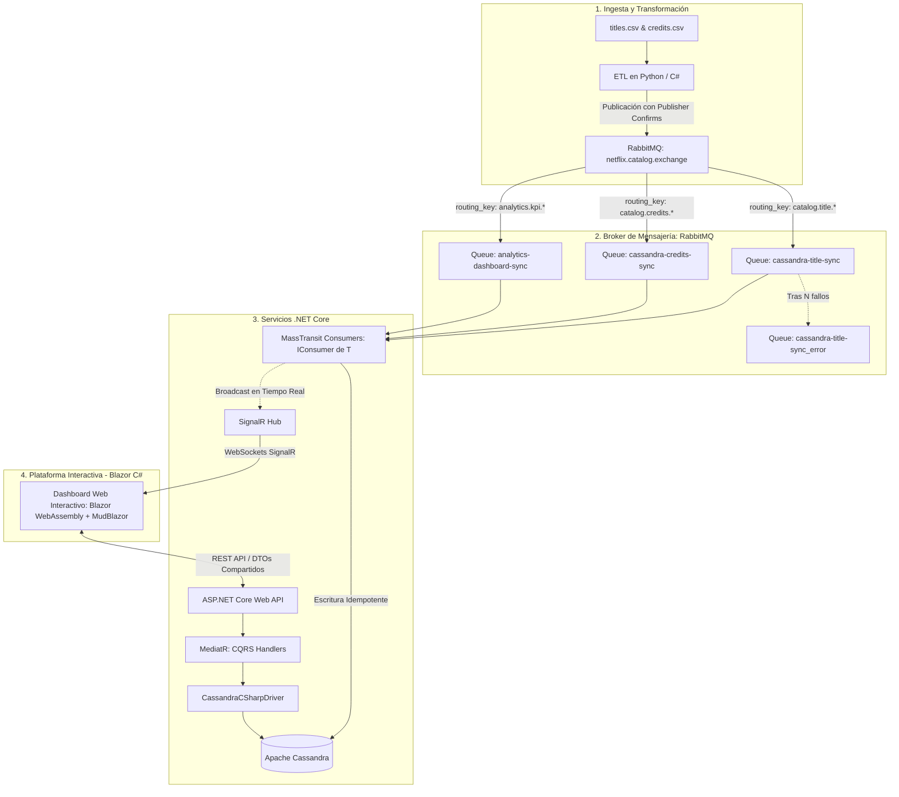
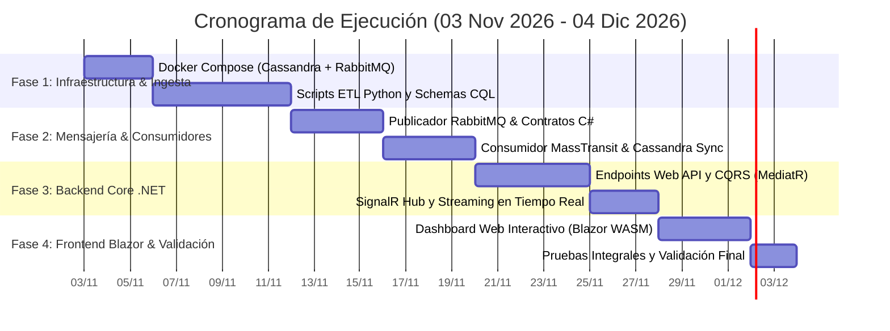

# Propuesta Técnica: Plataforma Analítica NoSQL con Apache Cassandra, Mensajería con RabbitMQ y Backend .NET

> [!NOTE]
> Documento técnico de referencia y control para el equipo de desarrollo. Consolida el análisis de datos de `archive/`, la arquitectura asíncrona con **RabbitMQ + MassTransit**, el modelado NoSQL en **Apache Cassandra** y el backend en **.NET** con **SignalR**.

---

## 1. Resumen Ejecutivo y Diagnóstico (`archive/`)

| Dataset | Registros | Atributos Clave | Diagnóstico Técnico |
| :--- | :--- | :--- | :--- |
| **`titles.csv`** (2.0 MB) | **6,137** | `id`, `title`, `type`, `release_year`, `runtime`, `genres`, `imdb_score`, `tmdb_popularity` | Colecciones serializadas como texto (`genres`, `countries`), nulos en series y scores. Requiere deserialización en ETL. |
| **`credits.csv`** (3.9 MB) | **81,355** | `person_id`, `id` (FK), `name`, `character`, `role` (76k actores, 4.7k directores) | Relación 1:N. Consultas relacionales tradicionales provocan cuellos de botella por `JOIN` masivos. Requiere desnormalización en Cassandra. |

### Tabla Comparativa AS-IS vs. TO-BE

| Dimensión | AS-IS (Relacional / CSVs) | TO-BE (Cassandra + RabbitMQ + .NET) |
| :--- | :--- | :--- |
| **Estructura** | Archivos planos rígidos con relaciones 1:N dispersas. | Modelo NoSQL desnormalizado en **Apache Cassandra** adaptado a consultas. |
| **Consultas** | `JOIN` pesados entre 81k créditos y 6k títulos. | Lectura directa por llave de partición; latencia sub-10ms sin `JOIN`. |
| **Integridad y Mensajería** | Ingesta acoplada y síncrona; fallos bloqueantes. | **RabbitMQ + MassTransit**: Asíncrono, *Publisher Confirms*, reintentos automáticos y colas de error (*DLQ*). |
| **Manejo de Errores** | Sin trazabilidad clara ante fallas de inserción. | Reintentos exponenciales y colas `_error` inspeccionables en la consola web de RabbitMQ. |
| **Consumo y Visualización** | Consultas estáticas sin tiempo real. | Backend **.NET (CQRS)** + **SignalR WebSockets** + Dashboard interactivo. |

---

## 2. Arquitectura Global y Mensajería con RabbitMQ



### Configuración de Tópicos y Enrutamiento en RabbitMQ:
- **Exchange:** `netflix.catalog.exchange` (Tipo `topic`, durable).
- **Enrutamiento:**
  - `catalog.title.created` / `catalog.title.updated` -> Cola `cassandra-title-sync`.
  - `catalog.credits.assigned` -> Cola `cassandra-credits-sync`.
  - `analytics.kpi.recalculated` -> Cola `analytics-dashboard-sync`.
- **Resiliencia:** Reintentos exponenciales configurados en MassTransit con enrutamiento automático a Dead Letter Queues (`_error`).

---

## 3. Modelo de Datos NoSQL en Apache Cassandra

```cql
CREATE KEYSPACE IF NOT EXISTS netflix_analytics
WITH replication = {'class': 'SimpleStrategy', 'replication_factor': 1};

USE netflix_analytics;

-- UDT para créditos embebidos
CREATE TYPE IF NOT EXISTS netflix_analytics.credit_summary (
    person_id bigint,
    name text,
    role text,
    character text
);

-- 1. Ficha completa del título con reparto embebido (Evita JOINs)
CREATE TABLE IF NOT EXISTS netflix_analytics.titles_by_id (
    id text PRIMARY KEY,
    title text,
    type text,
    description text,
    release_year int,
    age_certification text,
    runtime int,
    genres set<text>,
    imdb_score double,
    imdb_votes double,
    tmdb_popularity double,
    tmdb_score double,
    credits list<frozen<credit_summary>>
);

-- 2. Navegación por Catálogo: Tipo y Año (ordenado por año y valoración)
CREATE TABLE IF NOT EXISTS netflix_analytics.titles_by_type_year (
    type text,
    release_year int,
    imdb_score double,
    id text,
    title text,
    runtime int,
    genres set<text>,
    PRIMARY KEY ((type), release_year, imdb_score, id)
) WITH CLUSTERING ORDER BY (release_year DESC, imdb_score DESC, id ASC);

-- 3. Exploración por Género (desnormalizado por ítem de género)
CREATE TABLE IF NOT EXISTS netflix_analytics.titles_by_genre (
    genre text,
    type text,
    imdb_score double,
    id text,
    title text,
    release_year int,
    PRIMARY KEY ((genre), type, imdb_score, id)
) WITH CLUSTERING ORDER BY (type ASC, imdb_score DESC, id ASC);

-- 4. Trayectoria y Filmografía de Actores y Directores
CREATE TABLE IF NOT EXISTS netflix_analytics.credits_by_person (
    person_id bigint,
    role text,
    release_year int,
    title_id text,
    title text,
    person_name text,
    character text,
    imdb_score double,
    PRIMARY KEY ((person_id), role, release_year, title_id)
) WITH CLUSTERING ORDER BY (role ASC, release_year DESC, title_id ASC);

-- 5. Data Mart Preagregado: Contadores para Dashboard analítico
CREATE TABLE IF NOT EXISTS netflix_analytics.kpi_genres_summary (
    genre text,
    type text,
    decade int,
    total_titles counter,
    PRIMARY KEY ((genre), type, decade)
);

-- 6. Registro de Idempotencia para el Consumidor
CREATE TABLE IF NOT EXISTS netflix_analytics.processed_events (
    event_id uuid PRIMARY KEY,
    processed_at timestamp,
    event_type text
);
```

---

## 4. Pila Tecnológica y Despliegue Local con Docker Compose

```yaml
version: '3.8'

services:
  cassandra:
    image: cassandra:4.1
    container_name: netflix-cassandra
    ports:
      - "9042:9042"
    environment:
      - CASSANDRA_CLUSTER_NAME=NetflixCluster
      - CASSANDRA_DC=datacenter1
    volumes:
      - cassandra_data:/var/lib/cassandra

  rabbitmq:
    image: rabbitmq:3-management
    container_name: netflix-rabbitmq
    ports:
      - "5672:5672"    # AMQP para .NET y Python
      - "15672:15672"  # Consola web de gestión (http://localhost:15672)
    environment:
      - RABBITMQ_DEFAULT_USER=guest
      - RABBITMQ_DEFAULT_PASS=guest
    volumes:
      - rabbitmq_data:/var/lib/rabbitmq

volumes:
  cassandra_data:
  rabbitmq_data:
```

---

## 5. Decisiones Técnicas Acordadas

- [x] **Motor NoSQL:** Apache Cassandra (Keyspace `netflix_analytics`).
- [x] **Mensajería Asíncrona:** RabbitMQ + MassTransit en .NET con *Publisher Confirms* y *DLQ*.
- [x] **Framework de Backend:** .NET 10 con ASP.NET Core, MediatR (CQRS) y `CassandraCSharpDriver`.
- [x] **Capa en Tiempo Real:** ASP.NET Core SignalR vía WebSockets.
- [x] **Tecnología de Frontend:** Blazor WebAssembly (.NET 10) con MudBlazor (Arquitectura 100% C# Full-Stack).

---

## 6. Cronograma de Implementación (03 Nov 2026 - 04 Dic 2026)



| Fase | Período | Responsable Principal | Entregable Clave |
| :--- | :---: | :--- | :--- |
| **Fase 1: Infraestructura & Ingesta** | 03/Nov – 12/Nov | **Diana Paola Montes** | Docker Compose (Cassandra 4.1 + RabbitMQ) y Pipeline ETL en Python con schemas CQL y UDTs. |
| **Fase 2: Mensajería & Consumidores** | 12/Nov – 20/Nov | **Jonathan Cervantes** | Topología RabbitMQ, contratos C# y consumidores MassTransit con reintentos y DLQ. |
| **Fase 3: Backend Core .NET** | 20/Nov – 28/Nov | **Fernanda Baez** | Web API con CQRS (MediatR), CassandraCSharpDriver y Hub de SignalR en tiempo real. |
| **Fase 4: Frontend Blazor & Validación** | 28/Nov – 04/Dic | **Ximena Jasso** | Single Page Application en Blazor WASM + MudBlazor, pruebas de estrés y validación analítica. |

---

### Asignación de Roles del Equipo

- **Diana Paola Montes:** Líder de Datos NoSQL & Pipeline ETL (Cassandra, Docker y Python).
- **Jonathan Cervantes:** Ingeniero de Mensajería & Consumidores (RabbitMQ, MassTransit e Idempotencia).
- **Fernanda Baez:** Ingeniera de Backend .NET & APIs (ASP.NET Core, MediatR CQRS y SignalR).
- **Ximena Jasso:** Ingeniera de Frontend Blazor & UI/UX (Blazor WASM, MudBlazor y Validación).
